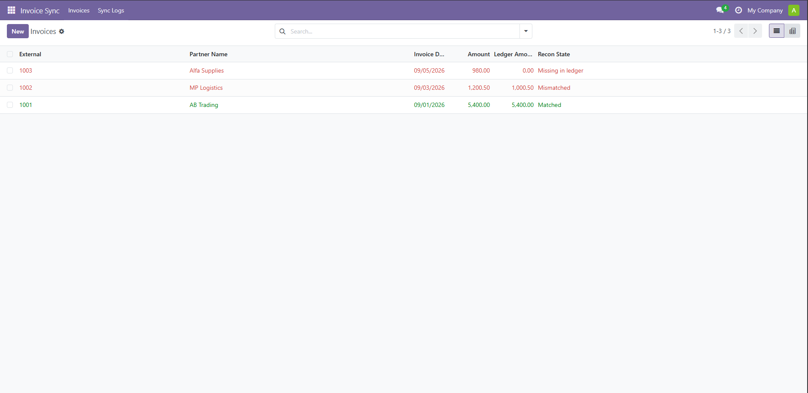
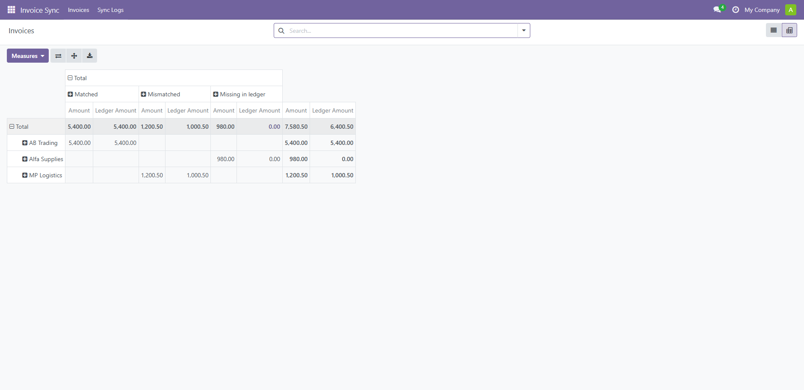
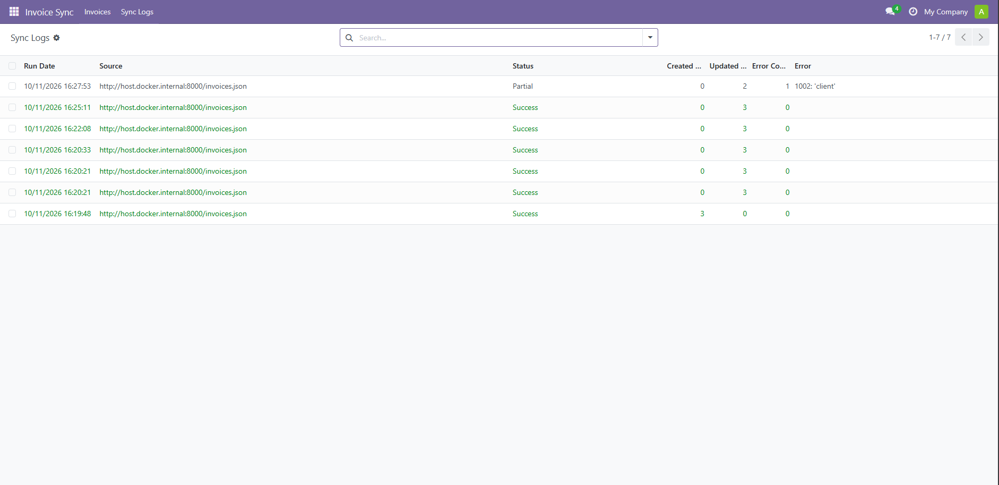
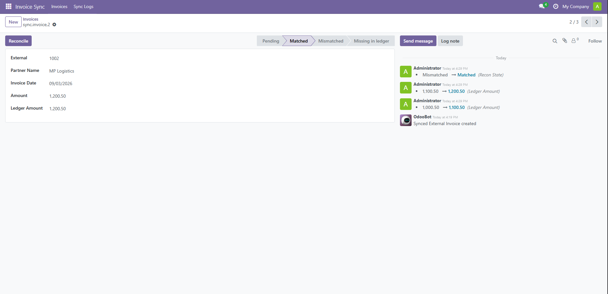
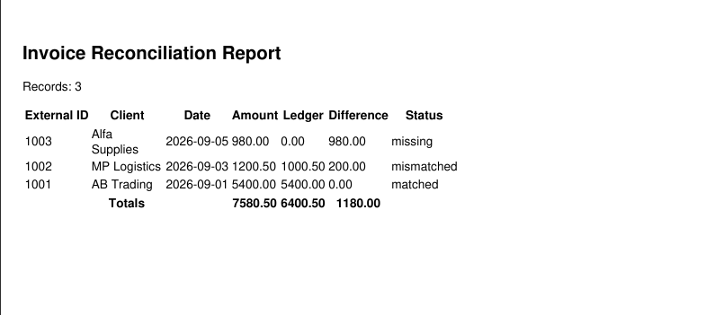

# Odoo Invoice Sync & Reconciliation

A custom Odoo 18 module that pulls external invoice data into Odoo, reconciles
it against ledger amounts, and keeps a full audit and run log.

## Features
- **Scheduled sync** (hourly cron) and an **authenticated push endpoint** (`POST /invoice_sync/push`) share one upsert routine
- **Reconciliation:** each invoice is marked matched, mismatched, or missing in ledger
- **Data integrity**
  - PostgreSQL unique constraint on `external_id`
  - Python validation (no negative amounts, no future dates)
  - Per-row savepoints, so one bad row never aborts the batch
  - Field-level audit trail via `mail.thread` tracking
- **System logs:** every run is stored in `sync.log` (status, created/updated/error counts, error text) and written to the Odoo server log
- **Reporting:** pivot view, QWeb PDF report, and an external XML-RPC client using `read_group`

## Stack
Python, Odoo 18, PostgreSQL 16, Docker Compose

## Run locally
```bash
docker compose up -d
python3 -m http.server 8000 --directory mock_api   # separate terminal
```
1. Open http://localhost:8069 and create a database named `odoo_dev`
2. Enable developer mode (`?debug=1`), then Apps -> Update Apps List
3. Install "Invoice Sync & Reconciliation"
4. Settings -> Technical -> Scheduled Actions -> Invoice Sync -> Run Manually

## Push endpoint
Set the system parameter `invoice_sync.api_key`, then:
```bash
curl -X POST http://localhost:8069/invoice_sync/push \
  -H "X-API-Key: <key>" -H "Content-Type: application/json" \
  -d '[{"id": 2001, "client": "Test Co", "amount": 300, "date": "2026-10-01", "ledger_amount": 300}]'
```
Returns `{"created": n, "updated": n, "errors": [...]}`. Responses use 401 for a bad key and 400 for invalid JSON.

## Project layout
```
addons/invoice_sync/
  models/        sync_invoice.py (upsert, reconcile, constraints), sync_log.py
  controllers/   main.py (push endpoint)
  views/         list, form, search, pivot views and menus
  report/        QWeb PDF reconciliation report
  security/      access rights
  data/          cron definition
scripts/rpc_client.py   external XML-RPC example
mock_api/invoices.json  sample data
```

## Design notes
- The upsert is keyed on `external_id`, so syncing or pushing the same data twice is safe
- Known limits: full fetch on every run, and no retry or alerting yet. Next steps would be incremental sync and batch commits for large volumes

## External XML-RPC client
```bash
export ODOO_USER="you@example.com"
export ODOO_API_KEY="<API key from Preferences -> Account Security>"
python3 scripts/rpc_client.py
```
Prints aggregates via `read_group`, creates a record, and shows a duplicate being rejected.

## Notes
- Credentials in `docker-compose.yml` (`odoo`/`odoo`) are demo defaults, and Postgres is bound to localhost only. Change both for anything real
- Keep secrets such as the API key and RPC credentials out of the repo (use environment variables)

## Screenshots
- Invoice list with reconciliation statuses
  
- Pivot view
  
- Sync log with a partial run
  
- Audit trail on an invoice
  
- PDF report
  
